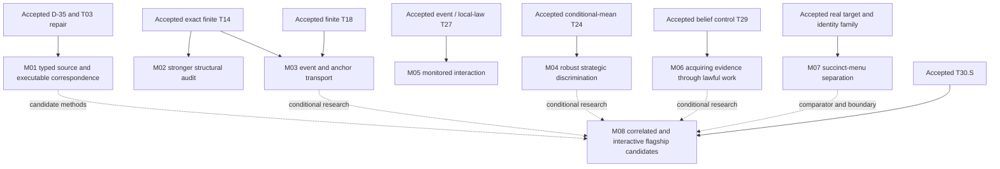

# Mathematical dependencies

Logical prerequisites are labelled explicitly. Similar mechanisms and measurements are cross-references only.

No arrow from a new uncontrolled transport or strategic theorem becomes an unconditional proof dependency before independent acceptance. The proposed serial frontier formulation will give its own correspondence and recurrence arguments. Distinguish the real composition law, actual usefulness, and calibrated evidence wherever transported.
