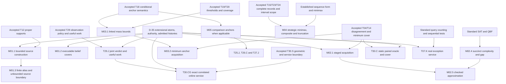

# Mathematical dependencies

Arrows encode actual dependencies for the new results. Additional literature and empirical analogies are listed below. The baseline statements and their scope are pinned separately. [Original foundation](BASELINE-MANIFEST.md)

T30.CG proves the physical serial correspondence and frontier-compression induction within its own statement. Its minimax argument instantiates T29.J. It does not assume the generalized M03 or M04 problem solved. M03 and M04 give complementary ingredients for a future quantitative and strategic flagship class. T30.C uses accepted implicit weighted cover applied to its separate paired oracle. M07 and M02.3 solve different noisy acquisition models. X01–X15 motivate or corroborate individual bounded examples and support requirements. They are not logical premises for new mathematical proofs.
